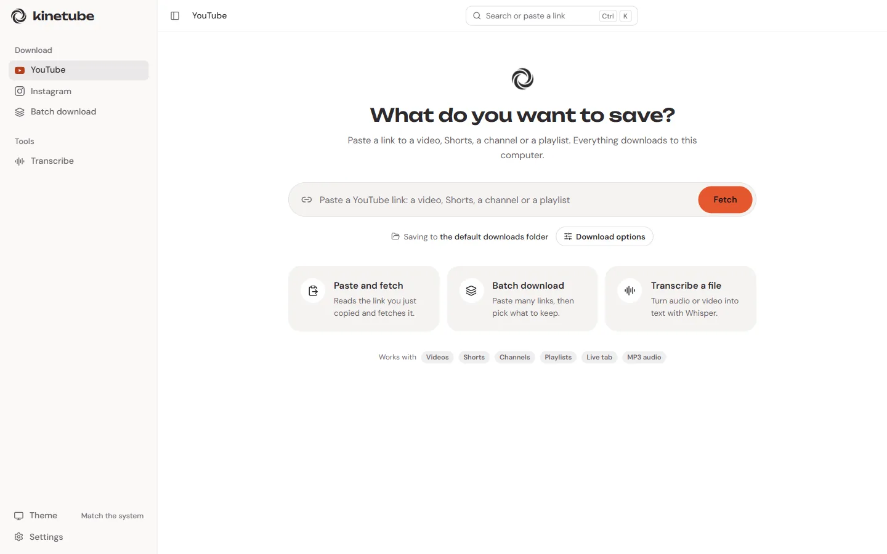
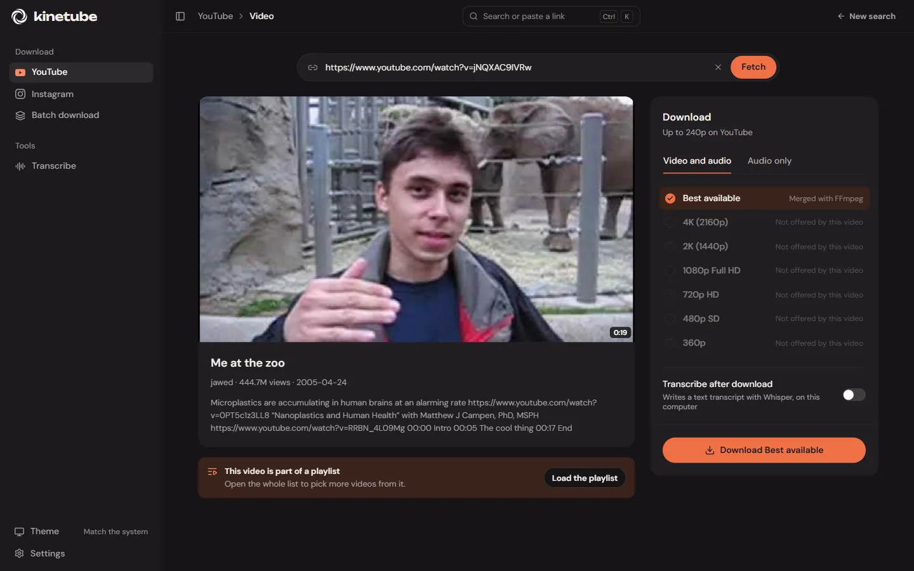
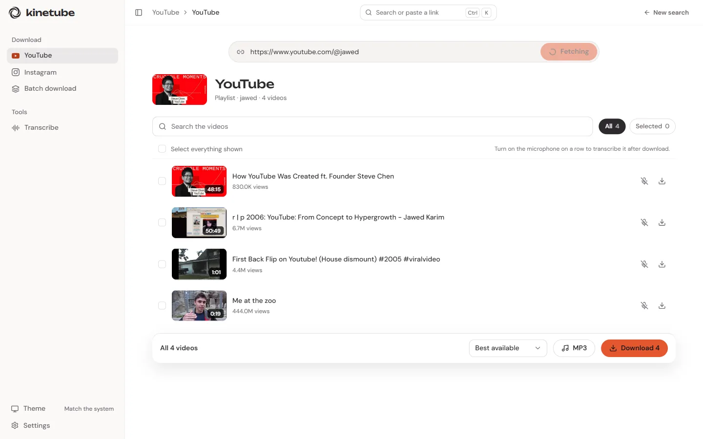
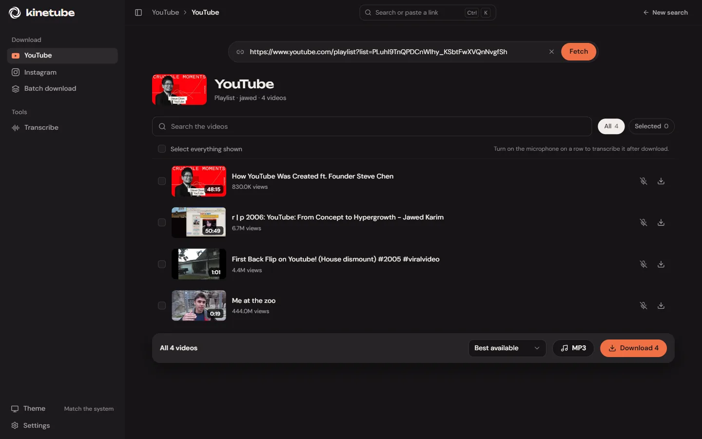
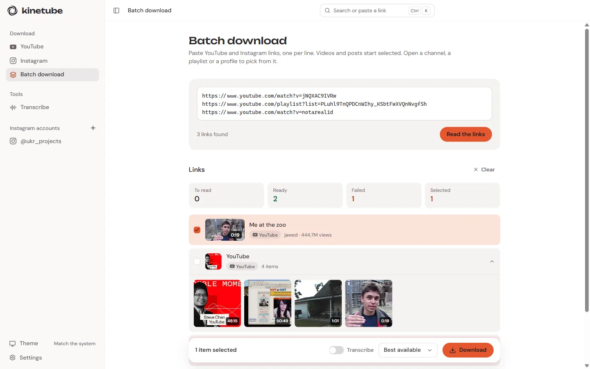
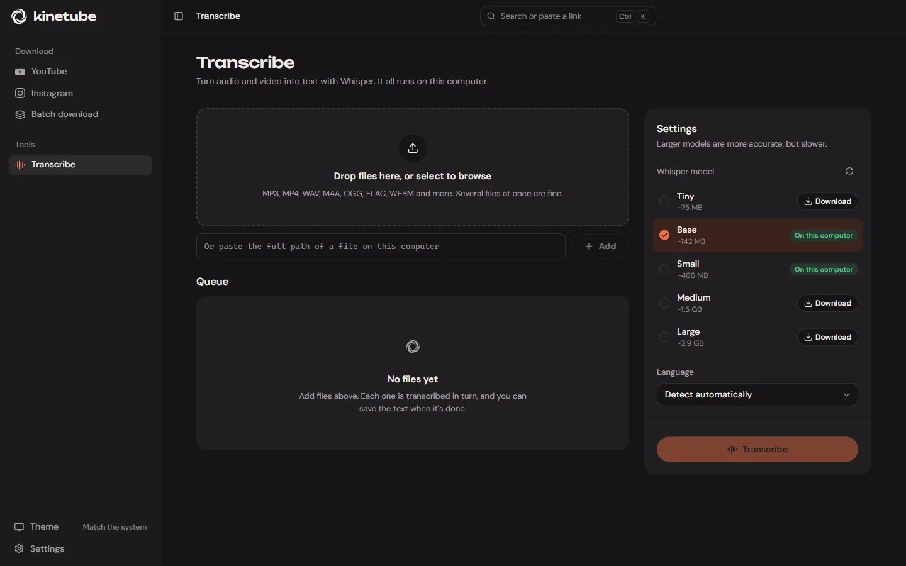
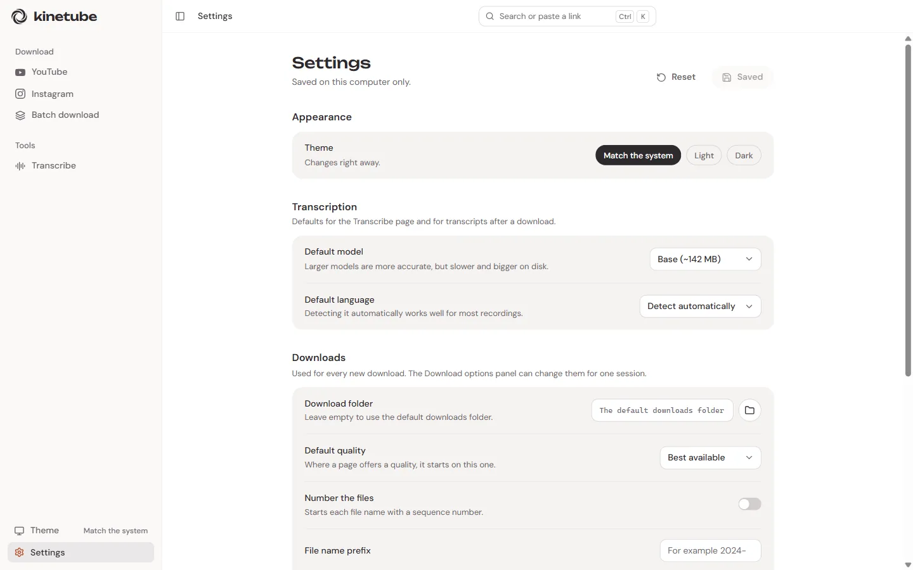
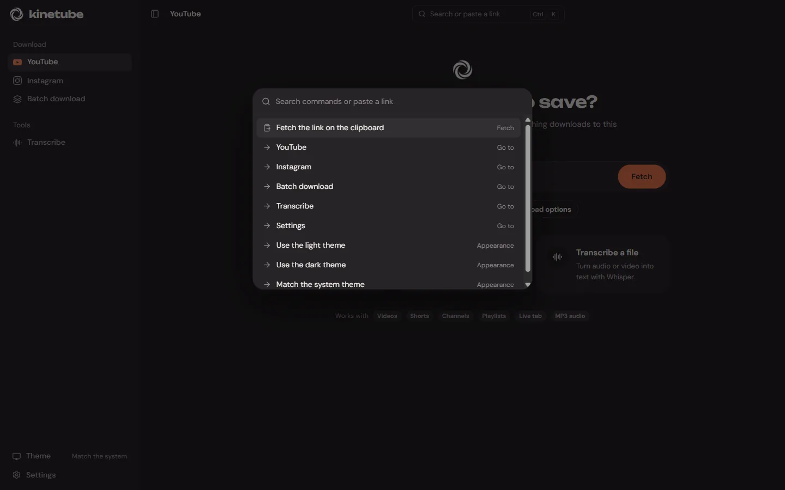
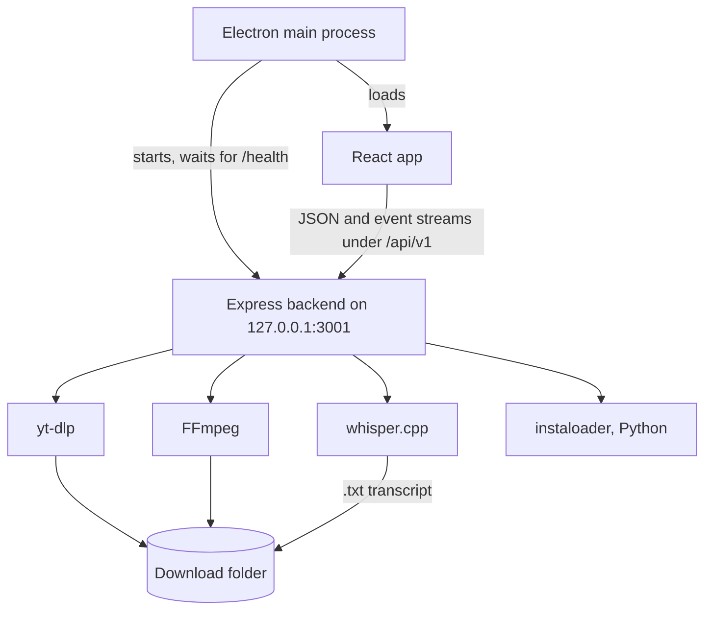

<p align="center">
  
</p>

<h1 align="center">kinetube</h1>

<p align="center">
  A desktop app that downloads YouTube and Instagram media and transcribes it on your own computer.<br/>
  No account, no subscription, no telemetry.
</p>

<p align="center">
  <a href="https://github.com/spacesdrive/kinetube/releases"></a>
  <a href="https://github.com/spacesdrive/kinetube/blob/main/LICENSE"></a>
  <a href="https://github.com/spacesdrive/kinetube/commits/main"></a>
  
  
</p>

---

## What kinetube does

kinetube saves videos and audio from YouTube and Instagram, and turns them into text with Whisper, a speech-to-text model that runs on your computer. It is an Electron app with a React interface and a small local Express server.

The real work is done by open-source tools: yt-dlp downloads, FFmpeg merges and converts, whisper.cpp transcribes, and instaloader reads Instagram profiles. kinetube installs yt-dlp and FFmpeg on first start, and the other two when you first need them.

The name is written `kinetube`, in lowercase, as the brand kit sets it. The current version is 2.0.0.

## Features

| Area | What you can do |
|---|---|
| YouTube videos | Download videos and Shorts at up to 4K (2160p). FFmpeg merges the video and audio for 1080p and above. The video page shows the preview beside a download panel with the qualities that video really has. |
| YouTube playlists | Open a playlist link, search and filter its videos, tick the ones you want and download them in one run. Private and deleted videos are marked and can't be picked. |
| YouTube channels | Open a channel and switch between its Videos, Shorts, Live and Playlists tabs. Upcoming and running streams are marked and can't be picked. Open any playlist from the Playlists tab. |
| Instagram | Download posts, reels and stories. Open a profile, load up to 500 posts, and download the ones you pick. |
| Audio | Save any video as an MP3. |
| Transcription | Transcribe downloaded or local audio and video files with whisper.cpp. Five model sizes, from Tiny (about 75 MB) to Large (about 2.9 GB). Detect the language automatically or pick one of 12. The transcript is saved as a `.txt` file next to the source. |
| Transcribe after download | Turn it on and every finished download is transcribed with your default model and language. |
| Batch download | A page of its own: paste many YouTube and Instagram links, one per line, including playlists and channels, pick what to keep and download it in one run. |
| Command palette | Press Ctrl and K (Cmd and K on macOS) to jump to any page, switch the theme, or paste a link and fetch it. |
| Pause and resume | Pause a single YouTube or Instagram download and resume it later from where it stopped. |
| Resume after closing | If the app closes during a download, the next start offers to resume it. Dismissing one shows an Undo. |
| Instagram accounts | Log in with two-factor authentication and keep several accounts. Profiles load with the account you choose. Removing an account asks you to press and hold, so it can't happen by accident. |
| File names | Add a prefix, a suffix or a sequence number, or use your own yt-dlp template such as `%(title)s`. |
| Progress | Speed, time left and the current step for every download, install and transcription. |
| Updates | The app tells you when a new version is out and installs it when you choose. Settings also checks for and installs a newer yt-dlp. |
| Look | The 2.0 redesign: the kinetube brand colours and type (Unbounded and DM Sans, bundled with the app), a light and a dark theme or the system's, and layouts that fit a 960 px window. |

## Screenshots

| | |
|---|---|
|  |  |
|  |  |
|  |  |
|  |  |

Every screen in both themes, at 1440 px and at 960 px, is in [`docs/screenshots/after/`](docs/screenshots/after/). The screens from before the redesign are in [`docs/screenshots/before/`](docs/screenshots/before/).

## Privacy

- kinetube has no server of its own, no account and no telemetry.
- The app contacts only YouTube and Instagram (with their image servers for thumbnails), and the hosts it installs tools and models from: GitHub, the FFmpeg build hosts, Hugging Face, and PyPI through pip.
- Downloads, transcripts, settings and Instagram sessions stay on your computer.
- The fonts ship inside the app, so no page loads anything from a font service.
- The local server listens on `127.0.0.1` only. It refuses requests from other web pages and from other host names, so a website you visit cannot use it.

## Requirements

To use the app:

- Windows, macOS or Linux. Windows is the tested platform; see [Known limitations](#known-limitations).
- An internet connection on first start, to install yt-dlp and FFmpeg.
- Python 3 with pip, only for Instagram login and Instagram profiles. kinetube installs the `instaloader` package for you.
- On macOS and Linux, transcription builds whisper.cpp from source, which needs `git`, `cmake` and a C/C++ compiler.

To build it from source:

- Node.js 22.18 or newer (`engines` in `package.json`). In development, Node runs the backend and the helper scripts as TypeScript directly, without a build step.
- On Windows, the .NET Framework 4. The root `npm install` uses its `csc.exe` to patch electron-builder's 7-Zip (see [`docs/workflows/RELEASE.md`](docs/workflows/RELEASE.md)).

## Run in development

```bash
git clone https://github.com/spacesdrive/kinetube.git
cd kinetube
npm install
cd frontend && npm install && cd ..
cd backend && npm install && cd ..
npm run dev
```

`npm run dev` does this:

1. Compiles the Electron code into `electron/dist/`.
2. Starts the backend with `node --watch src/server.ts` on `127.0.0.1:3001`.
3. Starts Vite on port 5173. Vite forwards `/api` to the backend.
4. Waits until `/health` and Vite answer, then opens the Electron window.

In development, tools, models, sessions and downloads are kept in `backend/`.

## Test and type check

```bash
npm run typecheck   # shared types, Electron, backend and frontend
npm test            # backend (node:test), then frontend (Vitest)
cd frontend && npm run lint
```

See [`docs/workflows/TESTING.md`](docs/workflows/TESTING.md) for what the tests cover and the manual checklist.

## Build installers

```bash
npm run dist:win    # Windows NSIS installer
npm run dist:mac    # macOS DMG (x64 and arm64), run on macOS
npm run dist:linux  # Linux AppImage
```

Each `dist` script compiles Electron, the frontend and the backend, then runs electron-builder. Installers land in `dist/`. The installer name comes from the root `package.json`, so version 2.0.0 builds `KineTube-Setup-2.0.0.exe` on Windows. The backend build removes the backend's dev dependencies, so run `cd backend && npm install` before you test or develop again. Releases are built by GitHub Actions when a `v*` tag is pushed; see [`docs/workflows/RELEASE.md`](docs/workflows/RELEASE.md).

## How it fits together



- In the installed app, Electron starts the backend in a utility process, shows a loading page, waits for `/health`, and loads the page from `http://localhost:3001`. The backend serves the built frontend.
- Long work (downloads, installs, transcriptions) streams progress as server-sent events: a response that stays open and sends one event per update. Closing the stream cancels a download or a transcription.
- The backend, frontend and Electron code are strict TypeScript. Request, response and event types live once in `shared/types/` and are shared by all three.
- The interface takes every colour, size and font from the design tokens in `frontend/src/styles/tokens.css`. [`docs/design-reference.md`](docs/design-reference.md) records where each value comes from.

## Project layout

```
kinetube/
  shared/types/        API request, response and stream-event types
  backend/
    src/
      routes/          one route table per resource, mounted under /api/v1
      controllers/     check input, call a service, send JSON or a stream
      validators/      turn untrusted input into typed requests
      services/        business rules for tools, media, downloads, transcriptions, folders
      stores/          JSON-file stores (download records, Instagram accounts)
      managers/        yt-dlp, FFmpeg, whisper.cpp, instaloader: install, locate, run
      platforms/       YouTube and Instagram link parsers and metadata mappers
      lib/, middleware/
    python/            instaloader helper scripts
    tests/             node:test
  frontend/
    src/
      services/        api.ts: every backend call
      features/        downloads, youtube, instagram, batch, transcribe, settings, setup
      components/      shell/ (sidebar, top bar, command palette), patterns/ (page building blocks), ui/ (shadcn)
      styles/          tokens.css: the design tokens
      pages/, hooks/, lib/, assets/brand/
    tests/             Vitest and Testing Library
  electron/            src/: main process, backend process, updater, IPC, preload. loading.html: the start-up page
  scripts/             patch-7zip.mts, run-electron.mts
  docs/                architecture, guidelines, workflows, design reference, screenshots
```

## API

The backend's HTTP API is versioned under `/api/v1`; `/health` stays at the root. Every route, its status codes and its stream events are listed in [`docs/architecture/backend/ROUTES.md`](docs/architecture/backend/ROUTES.md). The OpenAPI description is in [`docs/api/openapi.yaml`](docs/api/openapi.yaml).

The API is for the kinetube window only. It answers requests addressed to `localhost:3001` or `127.0.0.1:3001` from the app itself or the Vite dev server, and answers 403 to anything else.

## Settings

Settings are saved in the app's local storage and survive restarts and updates.

| Setting | What it does |
|---|---|
| Theme | Light, dark, or match the system. It changes at once, without Save. |
| Download folder | Where files are saved. When empty, kinetube uses its own `downloads` folder. |
| Default quality | The quality each page starts with |
| Numbering | Adds a sequence number to each file name |
| Prefix and suffix | Text added before or after every file name |
| Custom file name | A yt-dlp template, such as `%(title)s`, `%(uploader)s`, `%(upload_date)s` or `%(id)s` |
| Default Whisper model | Tiny, Base, Small, Medium or Large |
| Transcription language | Detect automatically, or one of 12 languages |

The YouTube and Instagram pages also have a Download options panel. It changes the folder and file names for this session only, without touching the saved defaults.

## Instagram setup

Public posts and reels need no setup. Instagram login and profiles use instaloader, which needs Python 3 on your `PATH`. When Python is found, kinetube offers to run `pip install instaloader` for you. You can also install it yourself:

```bash
pip install instaloader
```

Then log in from the sidebar on the Instagram page. Two-factor authentication is supported, and you can add several accounts and switch between them.

## Keyboard shortcuts

| Action | Shortcut |
|---|---|
| Open or close the command palette | Ctrl+K (Cmd+K on macOS) |
| Move through the commands | Up and Down arrows |
| Run the highlighted command | Enter |
| Look up the pasted link | Enter in the link field |
| Confirm a removal | Hold Space or Enter on a "Hold to" button |
| Open or close the developer tools | F12 |

## Known limitations

- Instagram downloads run logged out. instaloader saves its session in a format yt-dlp can't read, so post lookups and downloads do not use your login. Content that Instagram only shows to logged-in users can't be downloaded yet. Profiles do use the saved session. Exporting the session as cookies for yt-dlp is on the roadmap.
- macOS and Linux are not verified on real hardware. The tool setup for both is implemented and unit tested, but has not been run end to end on a real Mac or Linux machine. See [`docs/philosophy/CROSS_PLATFORM.md`](docs/philosophy/CROSS_PLATFORM.md).
- FFmpeg on Apple Silicon runs under Rosetta 2. The FFmpeg build kinetube downloads for macOS is x64 only, so Apple Silicon Macs need Rosetta 2.
- The backend's folder picker needs a dialog tool on Linux. `POST /api/v1/folders/pick` uses PowerShell on Windows, `osascript` on macOS, and zenity or kdialog on Linux, and answers 501 when none is there. The desktop app uses Electron's own folder dialog on every platform, so this only affects the frontend running in a plain browser.
- Only x64 Linux is supported. The Linux yt-dlp, FFmpeg and AppImage builds are x64.

## Issues

Bugs, feature requests and documentation work are tracked in [GitHub issues](https://github.com/spacesdrive/kinetube/issues), labelled `bug`, `enhancement` or `documentation`. Search there before you open a new one. Each change starts with an issue, and its commits name it (`Refs #12`, `Closes #12`); see [`docs/workflows/GIT.md`](docs/workflows/GIT.md).

## Contributing

1. Read [`CLAUDE.md`](CLAUDE.md) for the project rules and the map of the docs.
2. Open or find an issue for the change, so the approach is agreed before you start.
3. Fork the repository and create a branch from `main`.
4. Set up the project as described in [Run in development](#run-in-development).
5. Follow [`docs/workflows/FEATURE_DEVELOPMENT.md`](docs/workflows/FEATURE_DEVELOPMENT.md). Keep commits focused and reference the issue, as described in [`docs/workflows/GIT.md`](docs/workflows/GIT.md). For anything you can see in the app, follow [`docs/design-reference.md`](docs/design-reference.md).
6. Run `npm run typecheck` and `npm test` before you open a pull request.
7. Open a pull request that says what changed and why, and names the issue.

If your change touches yt-dlp, FFmpeg, whisper.cpp or instaloader, read [`docs/philosophy/CROSS_PLATFORM.md`](docs/philosophy/CROSS_PLATFORM.md) first.

## License

[MIT](LICENSE)
