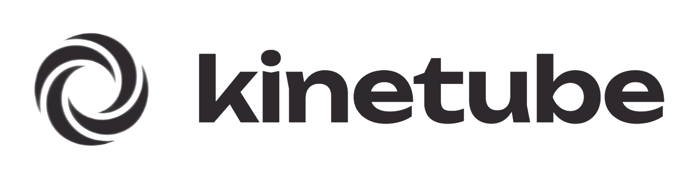
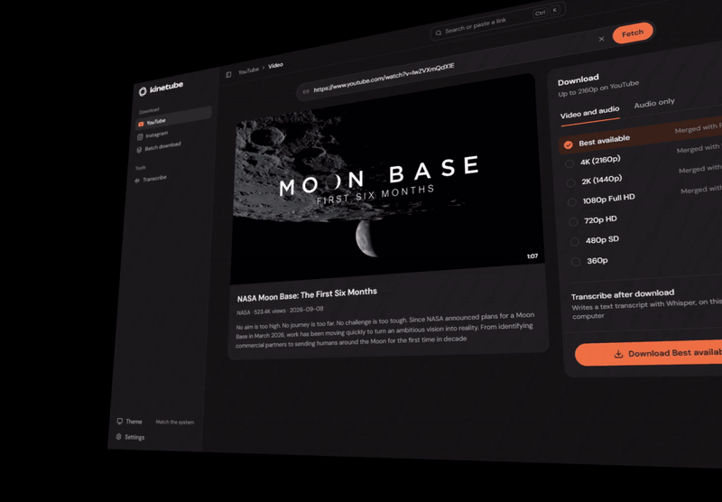
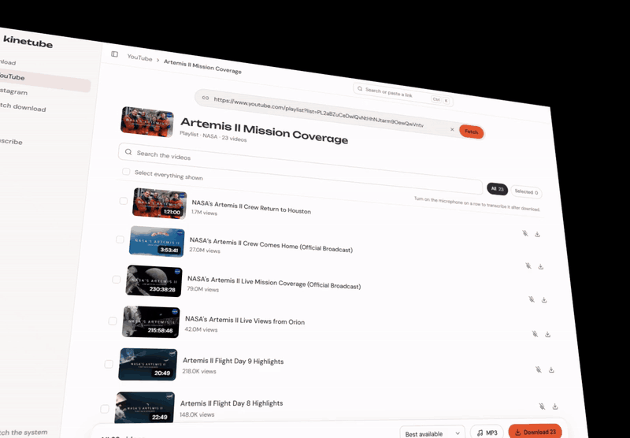
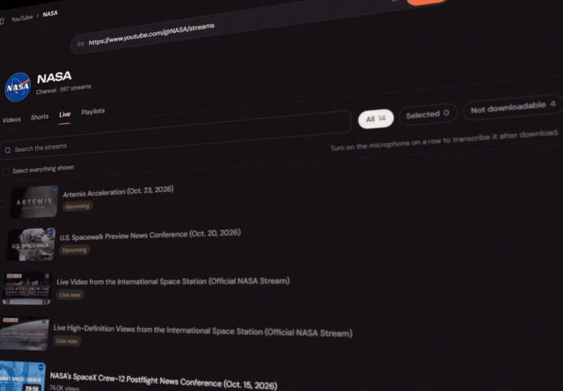
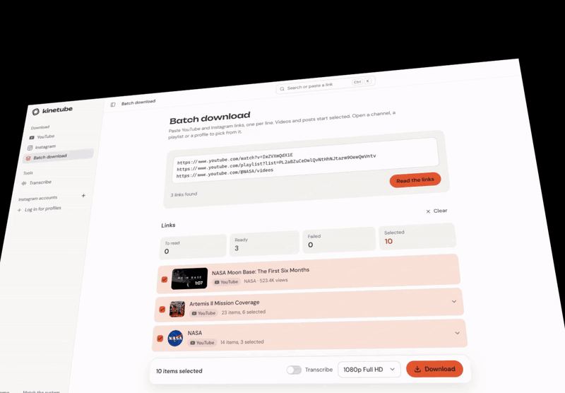
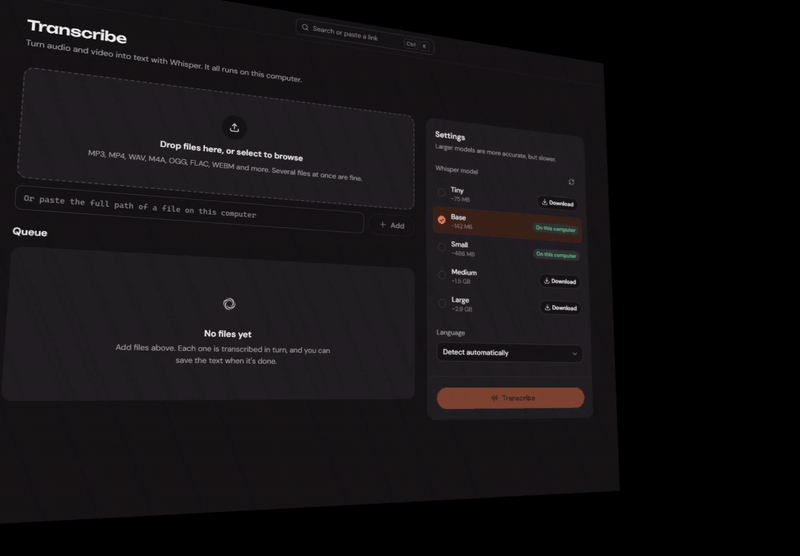
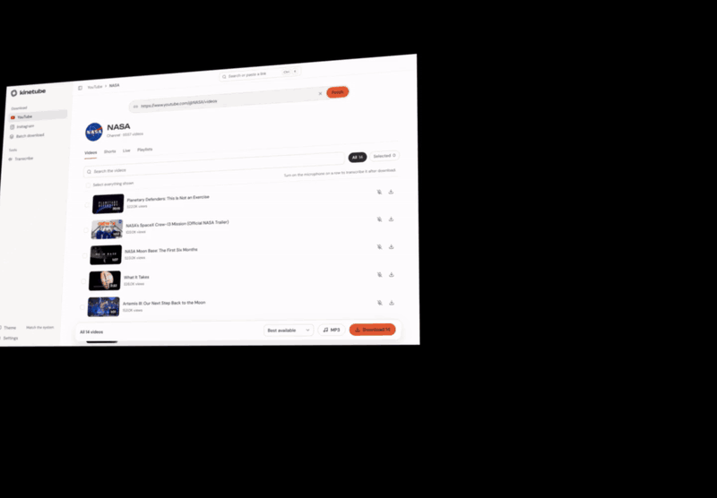
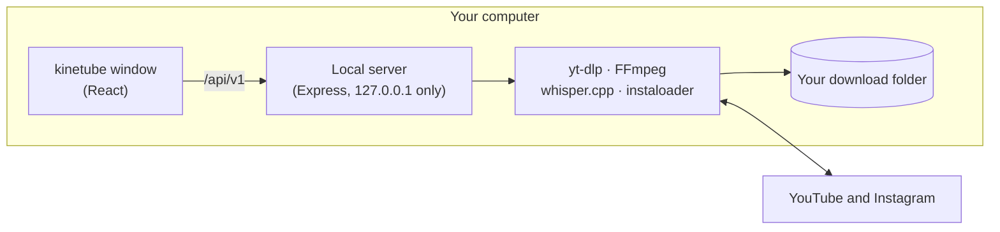
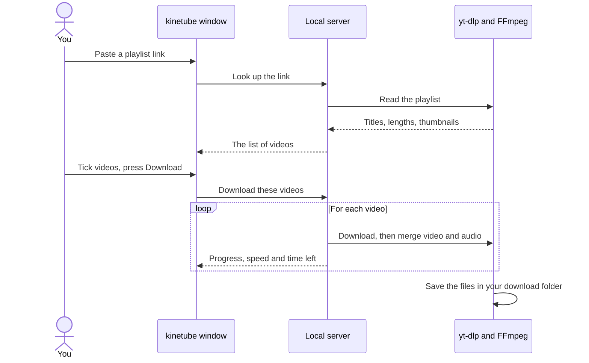

<div align="center">

<picture>
  <source media="(prefers-color-scheme: dark)" srcset="docs/media/kinetube-lockup-white.png">
  
</picture>

<h3>Save YouTube and Instagram media, then turn it into text.<br/>All on your own computer.</h3>

<p>kinetube is a free, open-source desktop app. It downloads videos, Shorts, playlists, channels, posts and reels,<br/>and transcribes them with Whisper. No account, no subscription, no telemetry.</p>

<p>
  <a href="https://github.com/spacesdrive/kinetube/releases/latest"></a>
  <a href="LICENSE"></a>
  <a href="https://github.com/spacesdrive/kinetube"></a>
  <a href="https://github.com/spacesdrive/kinetube/commits/main"></a>
  
</p>

<p>
  <a href="#install"><b>Install</b></a> ·
  <a href="#features"><b>Features</b></a> ·
  <a href="#how-it-works"><b>How it works</b></a> ·
  <a href="#documentation"><b>Documentation</b></a> ·
  <a href="CONTRIBUTING.md"><b>Contributing</b></a>
</p>



</div>

## Why kinetube

Many downloaders are websites full of ads, or apps that want an account and a monthly fee. Transcription services want your files on their servers first.

kinetube does both jobs on your machine. Paste a link, pick what you want, and the file lands in your download folder. Turn on transcription and a text file lands next to it. Nothing goes through a server of ours, because there isn't one.

The real work is done by open-source tools you may already trust. [yt-dlp](https://github.com/yt-dlp/yt-dlp) downloads, [FFmpeg](https://ffmpeg.org) merges and converts, [whisper.cpp](https://github.com/ggml-org/whisper.cpp) transcribes and [instaloader](https://github.com/instaloader/instaloader) reads Instagram profiles. kinetube installs them for you and puts them behind one window.

## Features

<table>
  <tr>
    <td width="50%" valign="top">
      
      <p><b>Pick from a playlist.</b> Open a playlist link, search it and tick the videos you want. Private and deleted videos are marked so you can't pick them.</p>
    </td>
    <td width="50%" valign="top">
      
      <p><b>Browse a whole channel.</b> Switch between its Videos, Shorts, Live and Playlists tabs. Streams that are live or still to come are marked.</p>
    </td>
  </tr>
  <tr>
    <td width="50%" valign="top">
      
      <p><b>Download in batches.</b> Paste many YouTube and Instagram links, one per line. Each one opens so you can pick from it, then it all downloads in one run.</p>
    </td>
    <td width="50%" valign="top">
      
      <p><b>Transcribe on your computer.</b> whisper.cpp turns audio and video into text. Pick a model from Tiny to Large and a language, or let it detect one.</p>
    </td>
  </tr>
  <tr>
    <td colspan="2" align="center">
      
      <p><b>Light, dark or your system's theme.</b> The fonts ship with the app, so nothing loads from the internet to draw the page.</p>
    </td>
  </tr>
</table>

| | What you get |
|---|---|
| **YouTube** | Videos and Shorts up to 4K, only in the qualities each video really has. Any video can also be saved as an MP3. |
| **Instagram** | Posts, reels and stories. Open a profile, load up to 500 posts and download the ones you pick. Log in with two-factor authentication and keep several accounts. |
| **Transcription** | Five Whisper models, from Tiny (about 75 MB) to Large (about 2.9 GB), and 12 languages. Turn on one switch and every finished download is transcribed too. |
| **Pause and resume** | Pause a download and continue it later. If the app closes in the middle of one, the next start offers to resume it. |
| **File names** | Add a prefix, a suffix or a number, or write your own yt-dlp template such as `%(title)s`. |
| **Command palette** | Press <kbd>Ctrl</kbd> <kbd>K</kbd> (<kbd>Cmd</kbd> <kbd>K</kbd> on macOS) to jump to a page, switch the theme or paste a link. |
| **Updates** | The app tells you when a new version of kinetube or yt-dlp is out and installs it when you choose. |

## Install

Download the installer for your system from the **[latest release](https://github.com/spacesdrive/kinetube/releases/latest)**.

| System | File |
|---|---|
| Windows (x64) | `KineTube-Setup-<version>.exe` |
| macOS (Intel and Apple Silicon) | `.dmg` |
| Linux (x64) | `.AppImage` |

The first start needs an internet connection, because kinetube installs yt-dlp and FFmpeg then. Whisper and instaloader are installed the first time you use them. Instagram profiles also need Python 3 on your computer.

> [!NOTE]
> Windows is the tested platform. The macOS and Linux builds come from the same release workflow, but they have not been run end to end on real hardware yet. [Cross-platform status](docs/philosophy/CROSS_PLATFORM.md) lists what is known.

### Run it from source

You need [Node.js](https://nodejs.org) 22.18 or newer.

```bash
git clone https://github.com/spacesdrive/kinetube.git
cd kinetube
npm install
cd frontend && npm install && cd ..
cd backend && npm install && cd ..
npm run dev
```

The app window opens once the local server and the interface are ready. [CONTRIBUTING.md](CONTRIBUTING.md) covers tests, builds and the Windows build requirement.

## How it works

kinetube is an [Electron](https://www.electronjs.org) app. The window is a [React](https://react.dev) interface, and a small local server runs the tools.



Here is what happens when you download part of a playlist:



Progress arrives as a live stream from the server, so the window always shows the current step. The [architecture overview](docs/architecture/OVERVIEW.md) explains the rest.

## Privacy

- kinetube has no server, no account and no analytics.
- It connects to YouTube and Instagram, and to the hosts it installs tools and models from: GitHub, the FFmpeg build hosts, Hugging Face and PyPI.
- Downloads, transcripts, settings and Instagram logins stay on your computer.
- The local server only answers the kinetube window. Other web pages and other computers on your network can't use it.

## Documentation

| Read this | To learn |
|---|---|
| [User guide](docs/USER_GUIDE.md) | Settings, Instagram setup, keyboard shortcuts and known limitations |
| [Contributing](CONTRIBUTING.md) | How to set up, test and build kinetube, and how a change gets in |
| [Architecture overview](docs/architecture/OVERVIEW.md) | How the window, the server and the tools fit together |
| [API routes](docs/architecture/backend/ROUTES.md) | Every route under `/api/v1`, also as [OpenAPI](docs/api/openapi.yaml) |
| [Design reference](docs/design-reference.md) | The brand, the layout and every design token |
| [Release workflow](docs/workflows/RELEASE.md) | How installers are built and published |
| [Changelog](CHANGELOG.md) and [roadmap](ROADMAP.md) | What changed, and what comes next |
| [Decisions](DECISIONS.md) | Why things are built the way they are |

## Contributing

Bug reports, ideas and pull requests are welcome. Start with an [issue](https://github.com/spacesdrive/kinetube/issues) so the approach is agreed before you write code, then follow [CONTRIBUTING.md](CONTRIBUTING.md). Help with testing on macOS and Linux is especially useful.

## Built with

[yt-dlp](https://github.com/yt-dlp/yt-dlp), [FFmpeg](https://ffmpeg.org), [whisper.cpp](https://github.com/ggml-org/whisper.cpp), [instaloader](https://github.com/instaloader/instaloader), [Electron](https://www.electronjs.org), [React](https://react.dev), [Tailwind CSS](https://tailwindcss.com), [shadcn/ui](https://ui.shadcn.com) and [Base UI](https://base-ui.com). The animations above are the real app, filmed with [Flute](https://github.com/webprodigies-org/flute).

Download only media you have the right to keep, and respect the terms of YouTube and Instagram.

## License

kinetube is released under the [MIT License](LICENSE).
