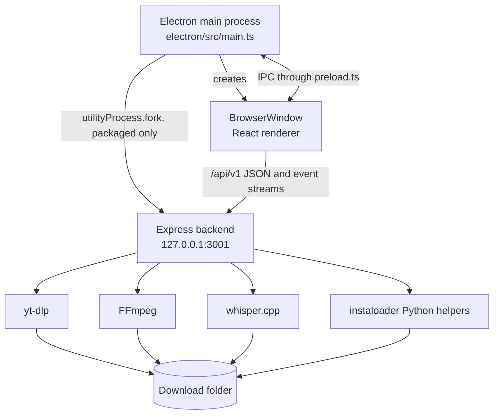

# Architecture overview

## Process topology

KineTube is one Electron app made of three processes.

| Process | Code | What it owns |
|---|---|---|
| Main | `electron/src/`, compiled to `electron/dist/` | The window, the updater, the native folder dialog and, in a packaged build, the backend process. See `docs/architecture/electron/MAIN_PROCESS.md`. |
| Renderer | `frontend/src/` | The React app built by Vite, with five pages: YouTube, Instagram, Batch download, Transcribe and Settings. It reaches the backend only through `frontend/src/services/api.ts` and reaches Electron only through `window.electronAPI`. See `docs/architecture/frontend/REACT_ARCHITECTURE.md`. |
| Backend | `backend/src/` | An Express 5 app that listens on `127.0.0.1` only. It does all file, network and process work, and serves the built frontend in a packaged build. See `docs/architecture/backend/EXPRESS.md`. |

`shared/types/` holds the request, response and stream-event types that all three use. Every project imports it with `import type`, so none of it exists at runtime (ADR-028).

## Backend layers

A request passes through these layers in order. Each one only calls the layer below it.

| Layer | Folder | Job |
|---|---|---|
| Routes | `backend/src/routes/` | One route table per resource. `apiRouter.ts` mounts them under `/api/v1`. |
| Controllers | `backend/src/controllers/` | Validate the input, call one service method, send JSON or a stream (`http.ts`: `sendStream`). |
| Validators | `backend/src/validators/` | Turn untrusted input into typed requests. They throw `ValidationError` or `NotFoundError`. |
| Services | `backend/src/services/` | The rules: tools, media lookups, downloads, batches, models, transcriptions, accounts, folders, the image proxy. |
| Stores | `backend/src/stores/` | JSON files on disk: pending downloads and Instagram accounts. |
| Managers | `backend/src/managers/` | One folder per tool. They download, install, locate and start the tool binaries. |
| Platforms | `backend/src/platforms/` | Pure URL parsers and yt-dlp JSON mappers for YouTube and Instagram. |

`backend/src/container.ts` builds every manager and service once at startup.

## The request pipeline

`backend/src/app.ts` sets up the pipeline in this order:

1. `requestContext` gives the request an id and writes one access log line when it finishes.
2. `originGuard` answers 403 unless the Host is `localhost:<port>` or `127.0.0.1:<port>`, and unless any Origin header is the app itself or the Vite dev server (ADR-026).
3. `GET /health` answers `{ ok: true, servesApp: true }`.
4. `express.json` reads JSON bodies up to 1 MB.
5. The `/api/v1` router handles the API. Any other `/api` path gets a 404 JSON error.
6. In a packaged build, `express.static` serves `frontend/dist`, with `index.html` for every other path.
7. `errorHandler` turns anything thrown into `{ success: false, code, message, requestId }`.

## Request lifecycle: a download from click to file

This is the path of a single YouTube or Instagram download.

1. The person picks a quality in the download panel of `VideoView` (`VideoDownloadPanel`) or in `InstagramPostView`, and clicks the download button. The view calls `onDownload`.
2. `AppShell` wires `onDownload` to `useDownloadSession().download`. It adds the Instagram account chosen in the sidebar and calls `startSingle` in `useActiveDownload`.
3. `startSingle` puts a fresh `SingleDownloadState` in the progress dialog. Then it calls `api.createDownload` with the link, quality, audio-only flag, account, download folder and file name options from the settings.
4. `openStream` in `frontend/src/services/eventStream.ts` sends `POST /api/v1/downloads` with a JSON body and `Accept: text/event-stream`. In development, Vite proxies `/api` to `127.0.0.1:3001`.
5. On the backend, the request passes `requestContext`, `originGuard` and `express.json`.
6. `downloadRoutes.ts` sends `POST /` to `downloadController.create`. The controller calls `parseCreateDownload` in `downloadValidators.ts`. It parses the link with the platform parsers and fills in a default for every missing option. A link that is not a single video, Short, post, reel or story fails here with a 400.
7. `downloadService.create` builds the download id from the clean link and the options. It calls `start` on the download runner, which checks that yt-dlp is installed (503 otherwise) and that the same download is not already running (409 otherwise). The runner then saves the record to `pending-downloads.json` and returns a stream job.
8. `sendStream` in `controllers/http.ts` opens the event stream (`lib/sse.ts`). It ties the response's `close` event to an `AbortController` and runs the job.
9. `runDownloadJob` calls `prepareDownload`. That picks the output folder and builds the yt-dlp arguments, with the link after `--`. The job sends `start` and any `warning` events, then calls `ytdlp.startDownload`.
10. The yt-dlp manager spawns the binary (`managers/ytdlp/ytdlpProcess.ts`) and splits its output into lines. The download tracker turns those lines into `title`, `phase`, `progress` and `log` events.
11. When yt-dlp exits, the job removes the pending record and sends `done`. On success it carries the title and the file path. On failure it carries a code and a message. A pause keeps the record and sends `paused` instead.
12. In the renderer, the stream reader splits the body on blank lines and parses each event. The handler in `useActiveDownload` passes each event to `applyDownloadEvent` in `singleDownloadState.ts`. `DownloadDialog` renders `ProgressModal` from that state.
13. If the person asked for a transcript, a successful `done` starts `usePostDownloadTranscription`, which streams `POST /api/v1/transcriptions`.

Closing the dialog closes the stream. The backend sees the response close, aborts the job and kills the yt-dlp process tree.

### Many videos at once

Playlists, channel tabs, Instagram profiles and the Batch download page all end in one download batch.

1. A playlist link or a channel tab link goes to `GET /api/v1/youtube/media`. The answer lists each entry with a `status`. A channel has four tabs (Videos, Shorts, Live and Playlists), and each tab is its own link and its own lookup.
2. The list in `features/youtube/VideoCollection.tsx` lets the person tick entries. Upcoming streams, running streams and unavailable videos can't be ticked.
3. The Batch download page (`features/batch/BatchPage.tsx`) looks up each pasted link the same way and starts single videos and posts selected.
4. The selection bar calls `onBulkDownload`. `useDownloadSession().downloadMany` adds the chosen Instagram account and calls `startBulk`, which streams `POST /api/v1/download-batches`. The progress dialog shows each item as it runs.

### Other streams

Tool installs, Whisper model downloads, transcriptions, download batches and Instagram profile lookups use the same pattern. The event names for each route are in `shared/types/`. The rules every stream follows:

- The last event is always `done`. It has `success: true` with a message and the result fields, or `success: false` with a `code` and a `message`.
- A `: keepalive` comment line goes out every 15 seconds.
- Closing the stream cancels downloads and batches and stops transcriptions and profile lookups. Tool installs and model downloads keep running.
- An error found before the stream opens (a bad link, a missing tool, a 409) is a normal JSON error.

See `docs/architecture/backend/ROUTES.md` for every route and its events.

## Data storage

`{dataDir}` is `ELECTRON_USER_DATA` when it is set, and the `backend/` folder otherwise (`backend/src/config.ts`). Every path below `{dataDir}` comes from `createAppPaths` in `backend/src/lib/paths.ts`.

| Data | Where | Notes |
|---|---|---|
| Tool binaries (yt-dlp, FFmpeg, whisper-cli and its libraries) | `{dataDir}/downloads/` | Downloaded on demand. `extraResources.filter` in `package.json` keeps the tool binaries, their libraries and archives in `backend/downloads/` out of the installer, for every platform's file names. |
| Downloaded media | The download folder from Settings, or `{dataDir}/downloads/` | Sent as `outputDir` with each request. A folder that does not exist falls back to the default with a `warning` event. |
| Whisper models | `{dataDir}/models/ggml-*.bin` | 75 MB to 2.9 GB, downloaded from Hugging Face when a model is picked. |
| Instagram sessions | `{dataDir}/sessions/session-<username>` | Written by the instaloader helper scripts. No route returns them. |
| Instagram account list | `{dataDir}/sessions/accounts.json` | `stores/instagramAccountStore.ts`, written atomically (write to a temp file, then rename). |
| Pending downloads | `{dataDir}/pending-downloads.json` | Running, paused and interrupted downloads, so the app can offer to resume them (ADR-017, ADR-020, ADR-031). |
| Backend log | `{userData}/backend.log` | Packaged builds only. Electron writes it and replaces it on every start. |
| App settings | Renderer `localStorage`, key `kinetube_settings` | `frontend/src/lib/settings.ts`. The backend never sees them. |

`localStorage` is kept per origin. The packaged window loads `http://localhost:3001`, the same origin as 1.x, so saved settings survive the upgrade. The development window loads `http://localhost:5173`, so it has its own separate settings.

## Development and packaged builds

| | Development (`npm run dev`) | Packaged |
|---|---|---|
| Electron | `tsc -b electron` runs first. Then `scripts/run-electron.mts` starts Electron once `wait-on` sees `http://127.0.0.1:3001/health` and `http://localhost:5173`. | The operating system starts the installed app. |
| Backend | `node --watch src/server.ts` in `backend/`. Node 22.18 or newer strips the types itself. | Electron forks `resources/backend/dist/server.js` in a `utilityProcess`, on Electron's own Node 20. |
| Page | The Vite dev server on `http://localhost:5173`, which proxies `/api` to `127.0.0.1:3001`. | The backend serves `frontend/dist`. The window shows `electron/loading.html`, then loads `http://localhost:3001` once `/health` answers. |
| Data folder | `backend/` | `app.getPath('userData')`, passed as `ELECTRON_USER_DATA`. |
| Environment variables | None set by Electron. `PORT` defaults to 3001. | `PORT`, `ELECTRON_APP`, `ELECTRON_USER_DATA`, `ELECTRON_FRONTEND_DIST` (see `MAIN_PROCESS.md`). |
| Logs | Printed in the terminal by `concurrently`. | Copied into `backend.log`. |
| Updater | `check-for-updates` answers `{ isDevMode: true }`. | `electron-updater` checks GitHub 5 seconds after start. |

## Rules that hold everywhere

1. **The backend listens before it does anything else.** `backend/src/server.ts` calls `app.listen` first and checks yt-dlp and FFmpeg only after the `listening` event. Electron polls `/health` a limited number of times.
2. Every writable path comes from `backend/src/lib/paths.ts`. Nothing the app writes at runtime uses a path relative to the code.
3. Only managers in `backend/src/managers/` start tool binaries. Services call manager methods such as `startDownload` and `transcribe`.
4. Long work streams events and ends with one `done` event. A paused download ends with `paused` instead.
5. The renderer has no Node access. `contextIsolation` is on and `nodeIntegration` is off, and the only Electron features it can reach are the ones `electron/src/preload.ts` exposes.
6. The API answers only KineTube's own window and dev server, on this computer (ADR-026).
